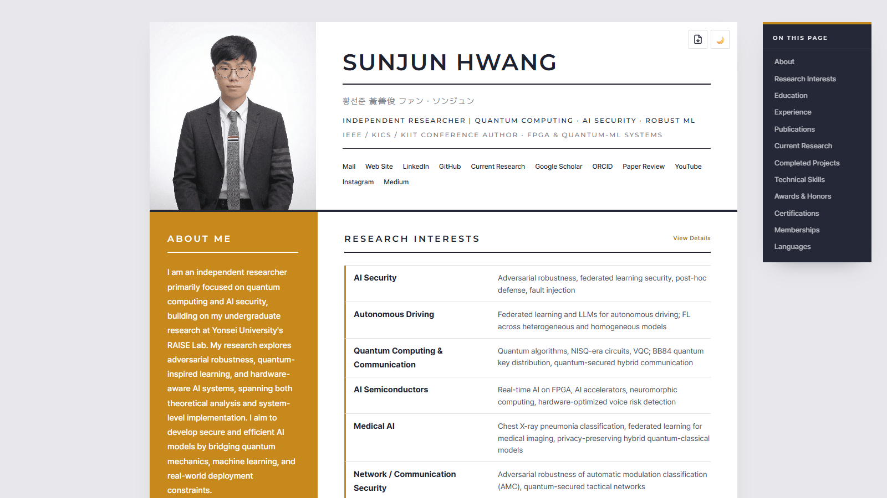

# CV — Sunjun Hwang

The curriculum vitae of **Sunjun Hwang (황선준 · 黃善俊 · ファン・ソンジュン)**, an independent researcher in quantum computing, AI security and robust machine learning.

**Live site:** [sjhwangcv.com](https://sjhwangcv.com)



## Sections

1. About
2. Research Interests — the same ten areas as the [research portal](https://sjhwangresearch.com)
3. Education
4. Experience
5. Publications
6. Current Research
7. Completed Projects
8. Technical Skills
9. Awards & Honors
10. Certifications
11. Memberships
12. Languages

## Two layouts, one page

The CV is a single HTML page with two independent looks:

| | Screen | Print / PDF |
|---|---|---|
| Stylesheet | `styles.css` + `theme.css` (`media="screen"`) | `styles.css` only |
| Look | Résumé sheet: navy photo band, amber About block, tracked headings, contents rail | Clean document layout for paper |
| Extras | Dark mode, intro splash, sticky table of contents | — |

Because `theme.css` is linked with `media="screen"`, the screen design can change freely without affecting the printed CV.

**Save as PDF:** use the download button in the top-right corner (or `Ctrl/Cmd + P`) and choose *Save as PDF*.

## Project structure

```
├── index.html      # All CV content
├── styles.css      # Base styles and the print layout
├── theme.css       # Screen-only résumé theme and dark mode
├── script.js       # Print button, dark mode, table of contents
└── assets/         # Profile photo, logos, favicon
```

## Running locally

No build step — it is a static site.

```bash
git clone https://github.com/justinbrianhwang/CV.git
cd CV
npx serve .
```

## Updating

All content lives in `index.html`. Add an entry by copying an existing item in the relevant section. After any change, check both the screen view and the print preview.

## Deployment

Hosted on **GitHub Pages** with the custom domain `sjhwangcv.com` (see `CNAME`). Pushing to `main` deploys automatically.

## Related

- [sjhwang.com](https://sjhwang.com) — personal website ([myweb](https://github.com/justinbrianhwang/myweb))
- [sjhwangresearch.com](https://sjhwangresearch.com) — research portal ([sjhwangresearch](https://github.com/justinbrianhwang/sjhwangresearch))

---

© 2026 Sunjun Hwang. All rights reserved.
